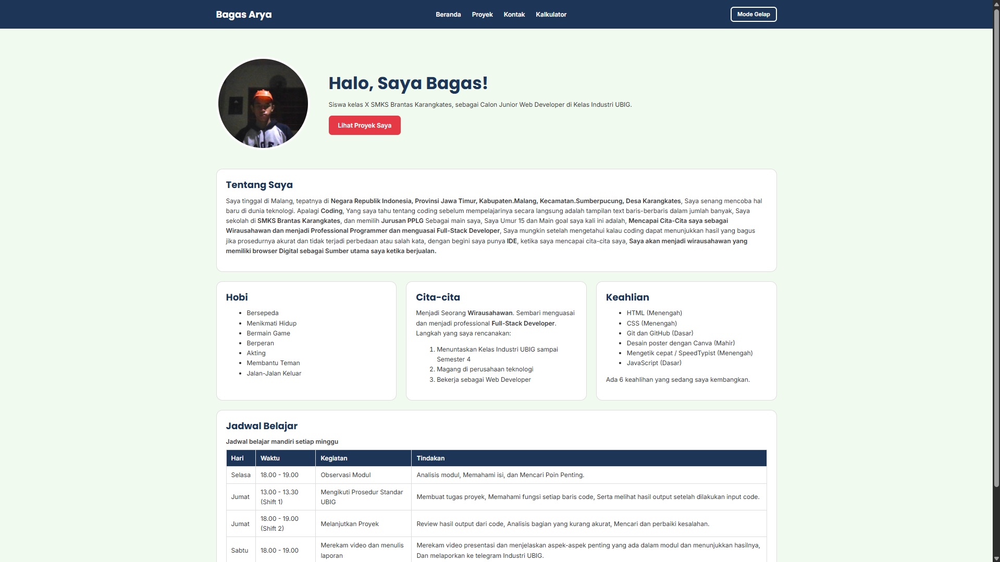
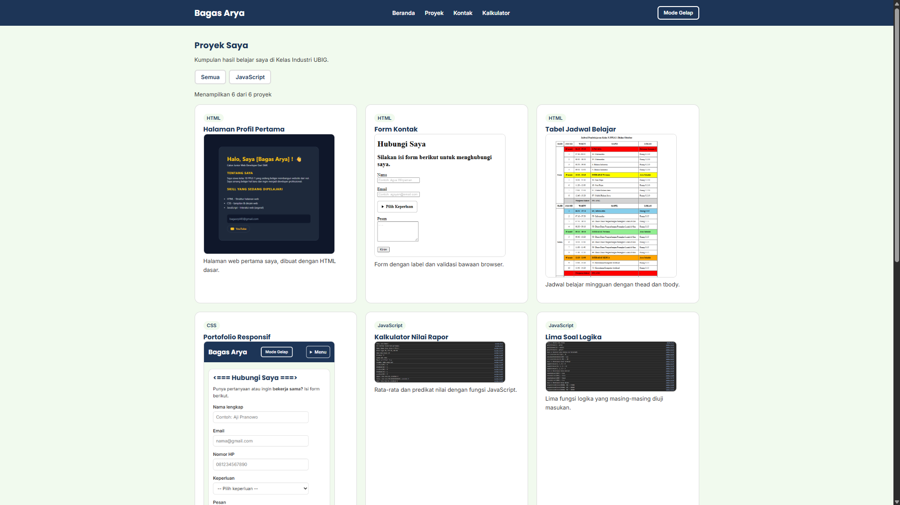
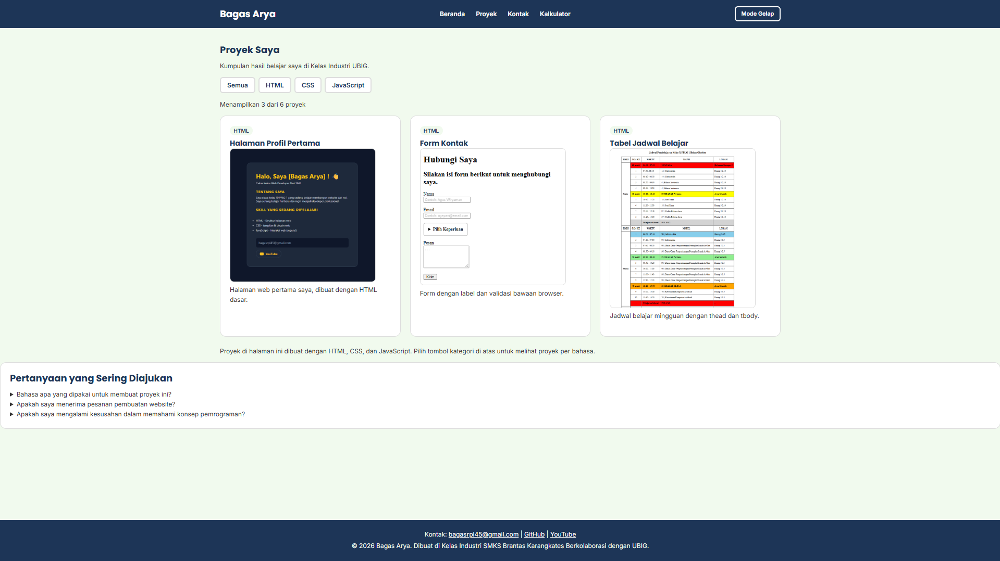
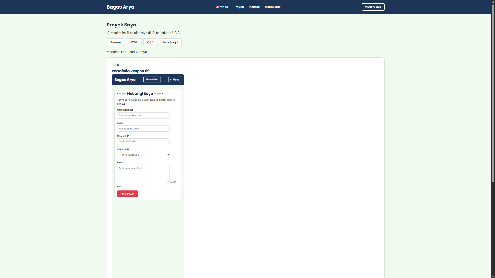
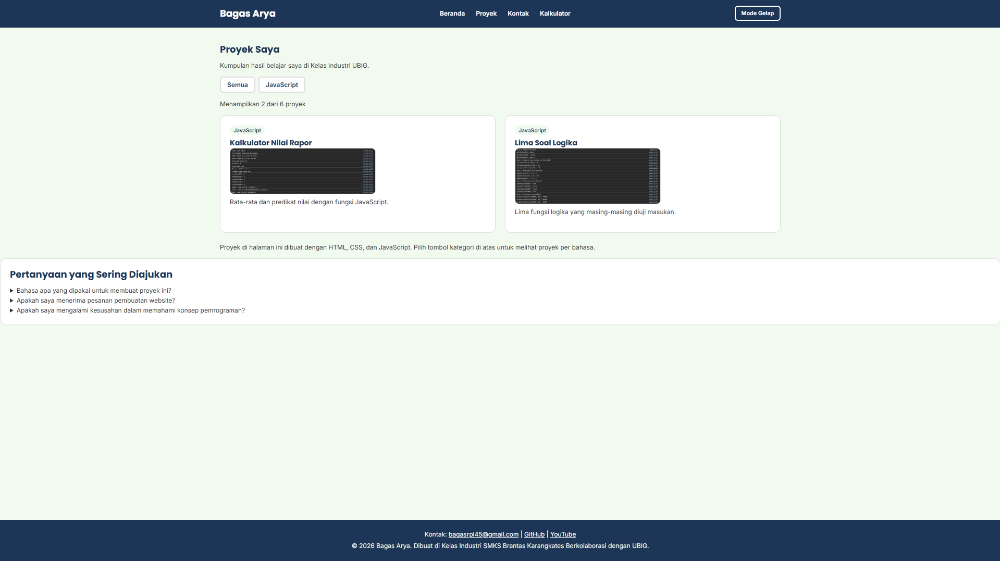
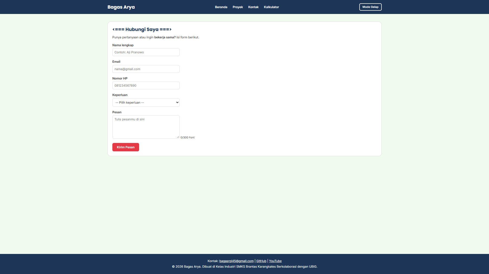
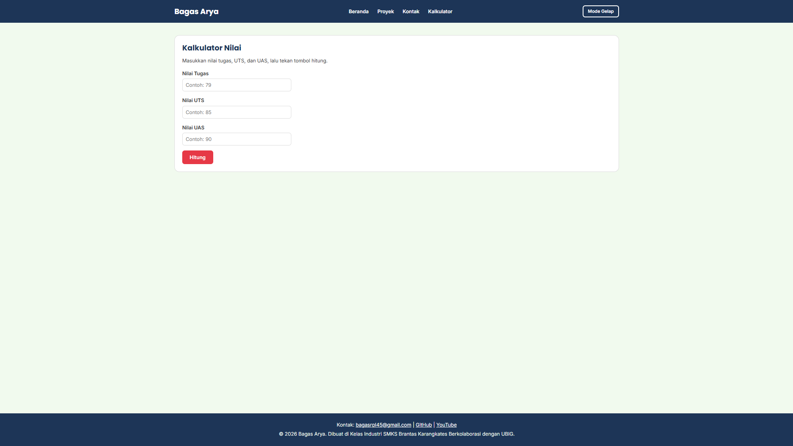
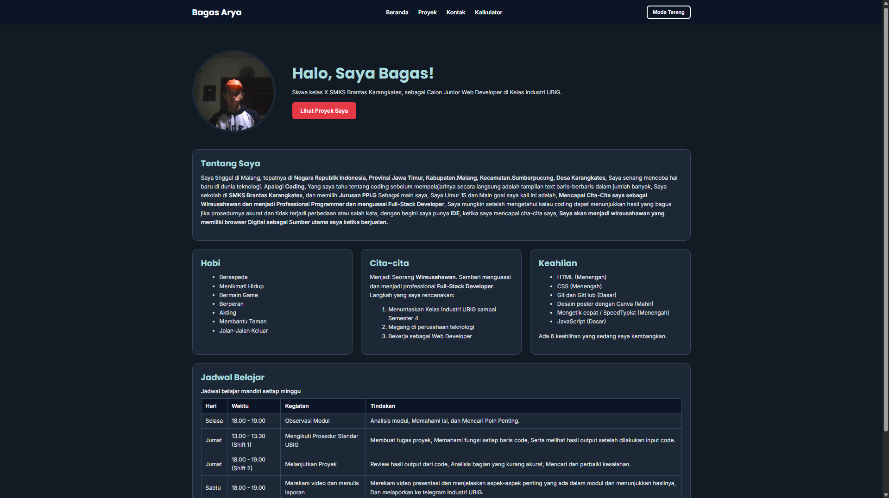

# Portofolio Bagas Arya
Website Portofolio pribadi yang saya buat di Kelas Industri SMKS Brantas Karangkates berkolaborasi dengan teaching class UBIG
(Paket 1, Minggu 01 sampai 05).
Website ini tampil rapi di ponsel, tablet, dan laptop.

## Tampilan

## Fitur
- Halaman **Beranda** berisi profil, hobi, cita-cita, keahlian, dan
jadwal belajar
- Halaman **Proyek** berisi daftar proyek dalam bentuk kartu dan memiliki tombol menunjukkan proyek dengan jenisnya
- Halaman **Kontak** berisi form untuk menghubungi saya
- Tampilan responsif dengan Flexbox dan *media query*
- Halaman **Kalkulator** berisi form penilaian nilai Tugas, UTS, dan UAS
- Tombol **Mode Gelap/Terang** yang dapat mengubah tema warna pada suatu HTML
- Tombol **All, HTML, CSS, JavaScript**yang dapat memilih untuk melihat projek mana yang dipilih sesuai dengan kemauan pengguna
## Teknologi
- HTML5
- CSS3 (Flexbox dan media query)
- Git dan GitHub
- VSCode dan Live Server
- JavaScript Dasar (Training)
- Vercel Upload & Preview
- Array of Objects
- DOM Dan Event
## Tautan
- Website: https://portofoliov1-bagasarya.vercel.app/
- Dibuat oleh: Bagas Arya, SMKS Brantas Karangkates
