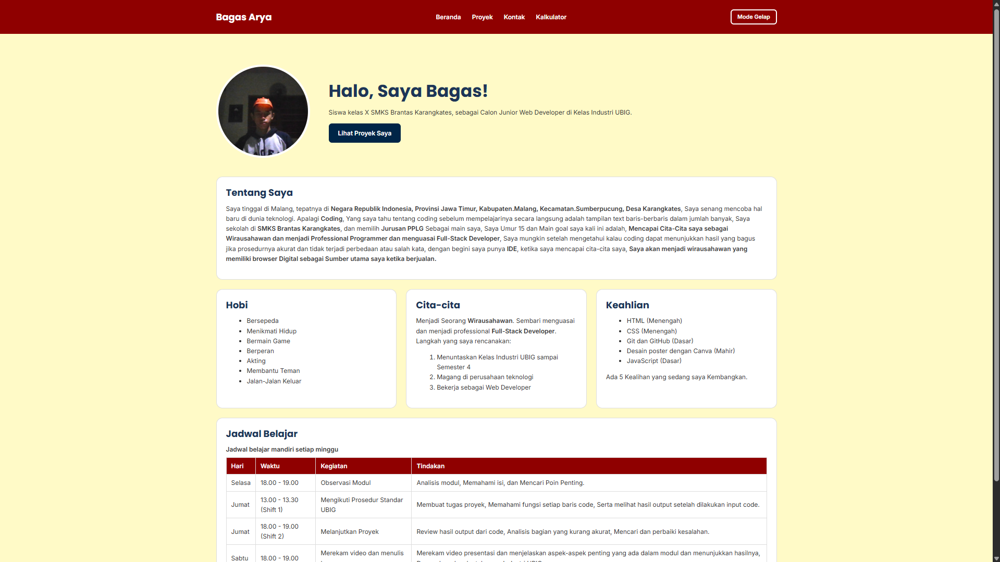
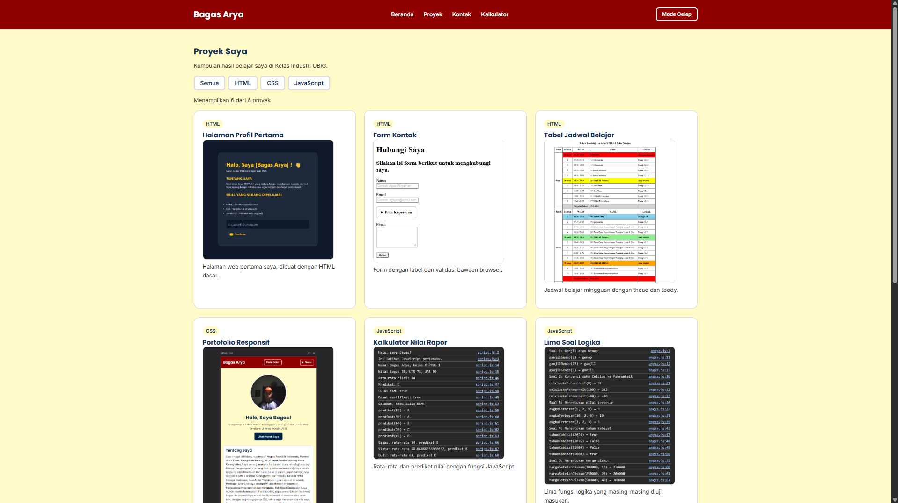
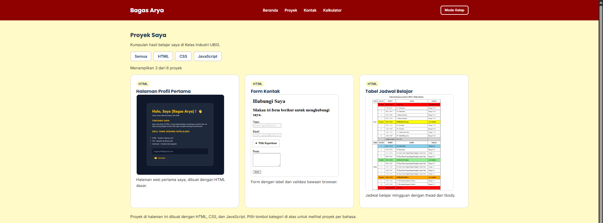
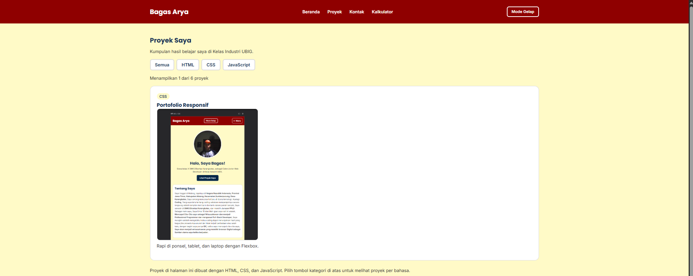
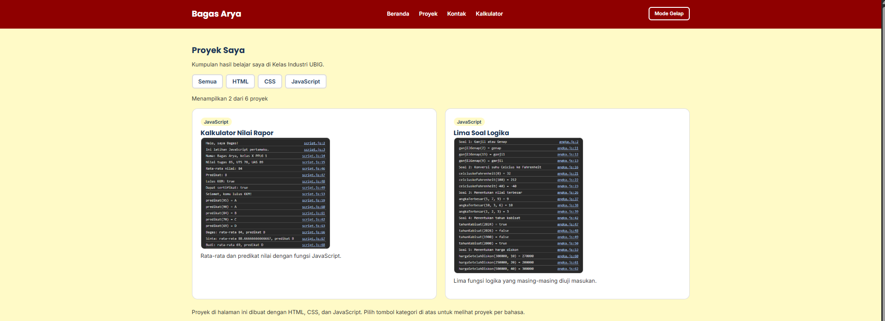
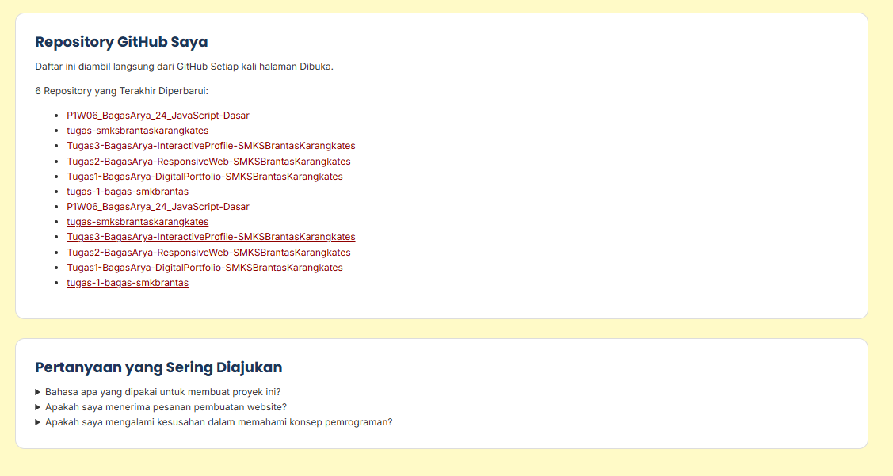
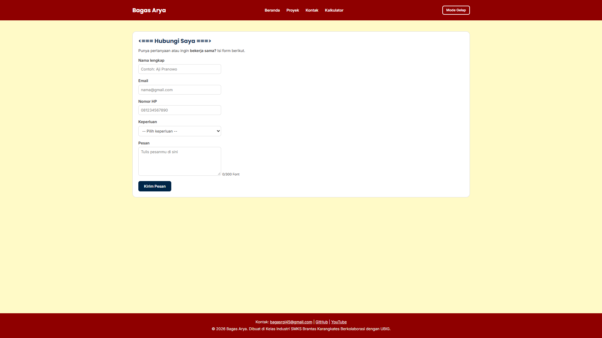
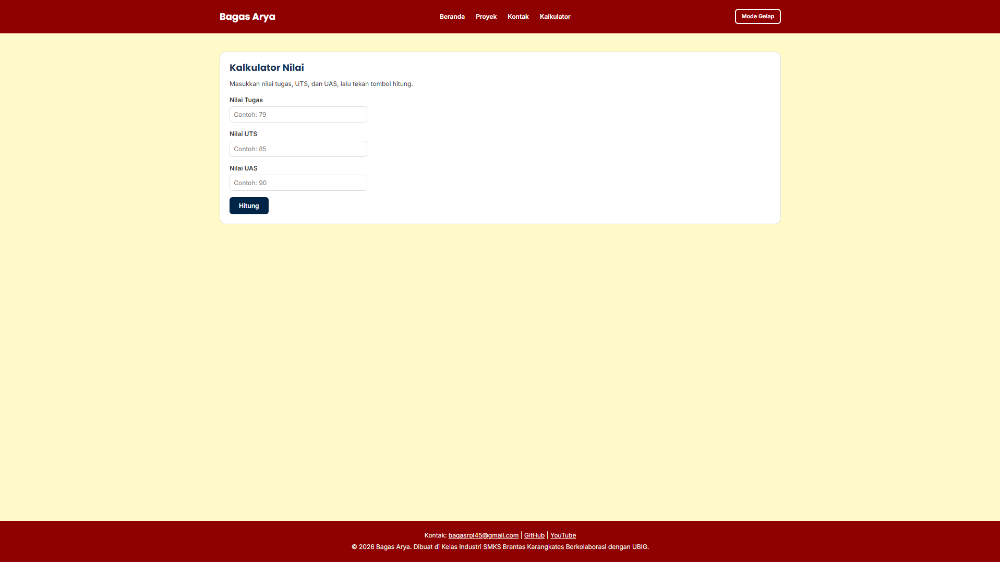
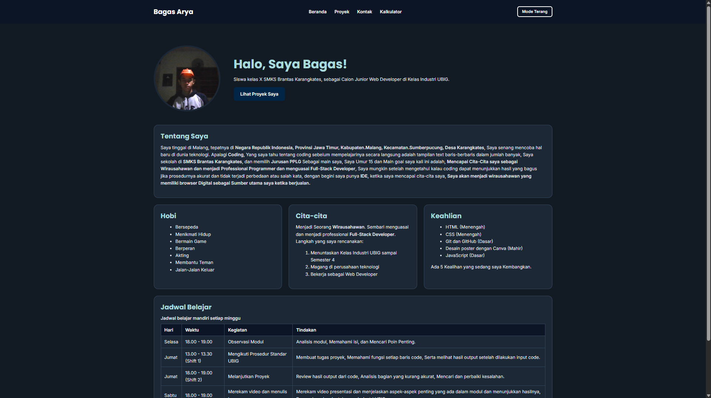

# Portofolio Bagas Arya
Website Portofolio pribadi yang saya buat di Kelas Industri SMKS Brantas Karangkates berkolaborasi dengan teaching class UBIG
(Paket 1, Minggu 01 sampai 08).
Website ini tampil rapi di ponsel, tablet, dan laptop.

## Tampilan

## Fitur
- Halaman **Beranda** berisi profil, hobi, cita-cita, keahlian, dan Jadwal Belajar.
- Halaman **Proyek** berisi daftar proyek dalam bentuk kartu dan memiliki tombol menunjukkan proyek dengan jenisnya
- Tombol **All, HTML, CSS, JavaScript**yang dapat memilih untuk melihat projek mana yang dipilih sesuai dengan kemauan pengguna
- **HTML** (Menampilkan proyek Berbasis HTML).
- **CSS** (Menampilkan proyek Berbasis Responsivitas CSS3 FlexBox).
- **JavaScript** (Menampilkan proyek berbasis JavaScript).
- Halaman **Repository GitHub dan beberapa Pertanyaan** Berisi Repository GitHub yang diperbarui secara Real-time dan beberapa ajukan pertanyaan mengenai Berkembangnya proyek ini.
- Halaman **Kontak** berisi form untuk menghubungi saya.
- Halaman **Kalkulator** berisi form penilaian nilai Tugas, UTS, dan UAS.
- Tampilan **Mode Gelap** Halaman Beranda yang menggunakan Latar Gelap ketika Tombol Mode Gelap Ditekkan.
- Tombol **Mode Gelap/Terang** yang dapat mengubah tema warna pada suatu HTML.
-
## Teknologi
- HTML5.
- CSS3 ( Flexbox dan media query ).
- Tampilan responsif dengan Flexbox dan *media query*
- Git dan GitHub.
- VSCode dan Live Server.
- JavaScript Dasar.
- Vercel Upload & Preview.
- Array of Objects.
- DOM Dan Event.
- JSON ( Data Lokal ).
- Fetch API dan ASync / Await ( GitHub REST API ).
-
## Tautan
- Website: https://portofoliov1-bagasarya.vercel.app/
- Dibuat oleh: Bagas Arya, SMKS Brantas Karangkates
